# Tico — revisão de UX e proposta de evolução

20 de outubro de 2026 · Auditoria de interface e comportamento · Proposta, sem implementação no app

**Recomendação: organizar o Tico em torno do resultado desejado, com configuração no próprio contexto e detalhes revelados conforme a necessidade.** O produto já possui prévias, busca de aplicativos e rascunhos úteis. A dificuldade está na distribuição das decisões: uma tela ampla leva a um formulário denso, ações semelhantes recebem nomes diferentes e opções técnicas aparecem antes das escolhas que poderiam resolvê-las.

O pedido de uma experiência robusta e minimalista é compatível com os recursos atuais. A proposta preserva a capacidade de automação e torna o caminho comum mais direto. Minimalismo aqui significa reduzir decisões desnecessárias, manter o estado da tarefa e deixar claro o que acontecerá.

## 1. Escopo e evidência

Três agentes revisaram frentes distintas em cópias isoladas do código:

| Frente | Cobertura |
|---|---|
| Criação e recursos existentes | Criador, edição, acionamentos, catálogos, biblioteca, modelos e descrição de automações |
| Experiências novas | Conteúdo, cenas, layout, revisão, recuperação e rotinas de telas |
| Navegação e aprendizagem | Shell, hierarquia, estados, Mapa, prática, aprendizado, permissões e critérios de acessibilidade |

A inspeção visual foi conduzida centralmente para evitar agentes disputando a interface. Foram salvas e examinadas **14 capturas atuais** de uma cópia temporária de `dist/Tico.app`, iniciada em modo de teste com dados isolados. Nenhuma ação de automação foi executada. O cenário considerou o usuário somente com a tela do Mac.

- **UI:** observação da interface nas capturas desta auditoria.
- **Fonte:** comportamento identificado no código atual; não equivale a execução real desse caminho.
- **Hipótese:** impacto esperado no uso, ainda sem pesquisa com participantes.
- **Proposta:** comportamento recomendado, ainda não implementado.

As prioridades são qualitativas. **P1** indica perda de contexto, consequência pouco clara ou dificuldade no caminho principal. **P2** indica consistência, descoberta e eficiência. Não representam frequência de incidentes nem prazo de desenvolvimento.

Não foi feito novo build para esta auditoria. Interface do binário existente e código do worktree são evidências distintas; os achados abaixo deixam essa distinção explícita.

## 2. Percurso inspecionado

| Etapa | Saúde da experiência | Evidência | Achado principal |
|---|---|---|---|
| 1. Consultar e editar um atalho | Atenção | 01 | Boa prévia, mas intenção e ativação repetidas em várias regiões; estado global distante |
| 2. Escolher e configurar uma ação | Alto atrito | 02–03 | A escolha visual leva a outra sheet; parâmetros técnicos antecedem receitas prontas |
| 3. Definir o acionamento | Alto atrito no trackpad | 04–05 | Gravação, escolha manual, combinação e personalização competem |
| 4. Conferir o atalho | Base útil, com ressalvas | 06 | Resumo causal é bom; a revisão de conteúdo não explicita o destino da pesquisa |
| 5. Consultar o Mapa e aprender | Alto atrito conceitual | 07–09 | Praticar, editar e aprender têm peso semelhante; objetivo ativo não mostra as teclas a usar |
| 6. Criar uma cena | Alto atrito no início | 10–11 | Rotinas dominam parte do vazio; nova cena começa com nome, explicação e aviso de incompletude |
| 7. Configurar rotina de telas | Alto atrito | 12–13 | Até seis seletores; comportamento e ativação efetiva exigem interpretação |
| 8. Descobrir automações | Atenção | 14 | Receitas ajudam, mas descrição, biblioteca, objetivo e criação global competem |

As imagens exatas estão no final deste documento, com a nota correspondente a cada estado. Layout capturado, revisão de janelas reais, recuperação, descrição textual e biblioteca de presets foram avaliados por fonte; não possuem captura de runtime nesta rodada.

## 3. Proposta para o caminho comum

### Criar e editar no mesmo fluxo

**Escolher resultado → completar o necessário → escolher acionamento → conferir.**

O editor mantém um único rascunho. O conteúdo da região de trabalho muda conforme a escolha, sem abrir uma segunda sheet para configurar uma ação comum.

Exemplos:

- **Abrir aplicativo:** mostrar busca e ícones; escolher Safari já completa a ação.
- **Abrir site:** perguntar “Qual site você quer abrir?”; mostrar o destino assim que informado.
- **Organizar janela:** escolher entre pequenas representações de esquerda, direita, inteira e outras posições.
- **Pesquisar conteúdo:** escolher Google, Documentação Apple ou Outro site; os parâmetros dos destinos conhecidos já vêm definidos.
- **Atalho do macOS:** procurar pelo nome ou escolher um disponível, com os requisitos de entrada apresentados naquele contexto.

O nome do atalho é sugerido a partir do resultado e pode ser editado. Sequências, atrasos, timeout, condições, scripts e políticas de falha continuam acessíveis por expansão junto à decisão correspondente. A edição de um item existente usa a mesma linguagem.

**Critério proposto:** uma ação comum deve ficar configurada sem abrir um editor secundário; um destino de exemplo nunca deve parecer uma escolha confirmada da pessoa.

Evidência: [abertura do editor secundário](../../Sources/Tico/Views/ShortcutComposerView.swift#L183), [ação com URL de exemplo](../../Sources/Tico/Views/Components/Rules/RuleActionKind.swift#L61). UI: capturas 02–03.

### Escolher um acionamento por reconhecimento

Apresentar duas entradas claras: **Gravar meu gesto** e **Escolher um gesto**. A primeira mostra a instrução e o resultado reconhecido. A segunda oferece uma pequena galeria adequada ao dispositivo.

> Reconheci: deslizar para a esquerda com 3 dedos\
> **Usar este gesto** · Gravar novamente

Dedos, movimento, modificadores, região, sequência e desenho continuam editáveis. O caminho comum não precisa começar por esses parâmetros. A galeria deve oferecer operação equivalente por teclado e VoiceOver; a gravação física não pode ser obrigatória.

**Critério proposto:** configurar um gesto comum sem preencher os pickers Dedos/Movimento, com um único próximo passo principal. Conflitos relevantes aparecem antes da ativação.

Evidência: [editor do acionamento](../../Sources/Tico/Views/Components/Rules/Composer/TriggerCaptureEditor.swift#L129). UI: capturas 04–05.

### Conferir uma frase que descreva o efeito

> Quando eu fizer **3 dedos para cima**, pesquisar **o texto selecionado** no **Google**, em **todos os apps**.

Cada trecho pode abrir a escolha correspondente. A revisão precisa mostrar o destino concreto, a origem do conteúdo e o alcance do atalho. “Pesquisar com conteúdo”, como aparece na captura 06, deixa parte importante do resultado implícita.

Separar claramente **Testar gesto**, cujo sucesso é “Gesto reconhecido”, de uma execução real com verbo específico, como **Abrir Safari agora**. Na fonte atual, “Funcionou!” depende do reconhecimento do acionamento; a explicação da simulação aparece mais abaixo.

Evidência: [copy de sucesso e explicação da prática](../../Sources/Tico/Views/Components/Rules/Composer/ComposerReviewStep.swift#L18).

## 4. Propostas para as funcionalidades novas

### Conteúdo: começar pelo destino e preservar a entrada — P1

**Observado:** Google e Documentação Apple aparecem abaixo do endereço HTTPS e do parâmetro de busca. O valor `q` fica visível sem um rótulo persistente. Origem, momento de captura e detalhes de permissão antecedem a escolha do resultado.

**Proposta:** receitas no início, seguidas por uma frase editável:

> Pesquisar **o texto selecionado** no **Google**.\
> O texto será enviado a google.com.

“Outro site…” revela URL e parâmetro, com rótulos permanentes. Momento de captura aparece em ajustes quando puder mudar o resultado de uma sequência. Não ler a seleção só porque o editor foi aberto.

**Achado de fonte:** o painel vazio leva à criação de um atalho. `createAction()` fecha e limpa a sessão antes de chamar a criação; texto e arquivos da sessão não são transferidos. As ações do painel dependem de regras habilitadas que correspondam ao contexto.

**Proposta de fluxo:** configurar uma receita e retornar à mesma entrada transitória. A pessoa pode usar o conteúdo imediatamente e, depois, escolher “Usar também com um gesto”. Isso exige uma decisão explícita sobre ação manual reutilizável e acionamento opcional; esconder um gatilho artificial não resolve a dependência de modelo.

**Aceitação:** Google/Apple sem parâmetros técnicos; cancelar a configuração mantém a entrada dentro da sessão; conteúdo não é persistido; origem e destino ficam visíveis antes de executar.

Fontes: [editor de conteúdo](../../Sources/Tico/Views/Components/Content/ContentActionEditorView.swift#L15), [fechamento da sessão](../../Sources/Tico/Support/ContentInteractionCoordinator.swift#L107), [criação da regra de conteúdo](../../Sources/Tico/Views/ContentView.swift#L460). UI: captura 03.

### Cenas: construir a disposição visualmente — P1

**Observado:** “Nova cena” abre “Editar cena”, foca o nome genérico e mostra um aviso de incompletude antes de qualquer tentativa. A página vazia dá muito espaço a rotinas ainda indisponíveis.

**Proposta:** duas tarefas de entrada:

- **Guardar minha disposição atual:** captura explícita e revisão.
- **Montar uma cena:** escolher aplicativos e resultados.

A edição apresenta um mapa abstrato de telas e janelas, com ícones de apps. Selecionar uma janela revela seus controles. Esquerda, direita, inteira e terços usam posições visuais; porcentagens ficam em precisão avançada.

Para este cenário, o destino inicial é **Tela do Mac**. “Planejar para outra tela…” permite preparar monitores ausentes. A fonte atual lista papéis de monitor em cada janela, independentemente do equipamento presente. O canvas já existe na revisão e pode orientar a linguagem da edição; a interação de edição ainda precisa ser desenhada.

**Aceitação:** guardar duas janelas na tela do Mac sem escolher papel de monitor ou preencher porcentagens; nunca resolver arbitrariamente duas janelas do mesmo app; manter alternativa completa por teclado; não persistir screenshots nem títulos de documentos.

Fontes: [configuração do layout](../../Sources/Tico/Views/Components/Scenes/SceneLayoutConfigurationView.swift#L25), [controles de cada janela](../../Sources/Tico/Views/Components/Scenes/SceneLayoutWindowEditor.swift#L16). UI: capturas 10–11. O editor após captura foi avaliado somente por fonte.

### Rotinas: nascer dentro da cena e mostrar o estado efetivo — P1

**Observado:** três seletores iniciais e mais três ao expandir ambiente. A rotina nasce pausada. **Fonte:** a primeira cena válida é escolhida automaticamente; existe também pausa global; “automático” pode resultar em confirmação dependendo das ações.

**Proposta:** começar em uma cena por **Usar quando…**, preenchendo uma frase:

> Quando **eu conectar uma tela**, **oferecer a cena Trabalho**.

O nome pode ser sugerido. “Ajustar ambiente” permite condições específicas e, quando adequado, usar a configuração atual. O CTA informa o efeito: **Ativar sugestão**, **Ativar execução automática** ou **Salvar pausada**. Se a cena exigir confirmação, o modo deve mostrar **Confirmar antes de executar**, com o motivo.

Sem monitor externo, permitir preparar a rotina e mostrar “Esperando uma tela externa”. Demonstração sintética deve ser identificada como demonstração; não comprova conexão física.

**Aceitação:** entender se está pausada, pronta ou esperando hardware; nenhuma cena escolhida arbitrariamente; modo exibido corresponde à execução; a pausa global tem lugar único e aparece no estado efetivo de cada rotina.

Fontes: [editor](../../Sources/Tico/Views/Components/DisplayRoutineEditorView.swift#L20), [cena inicial](../../Sources/Tico/Views/Components/DisplayRoutineSectionView.swift#L55), [descrição do modo efetivo](../../Sources/Tico/Views/Components/DisplayRoutineEditorView.swift#L72). UI: capturas 12–13.

### Aprendizado: mostrar o próximo uso, com estados independentes — P1

**Observado:** Praticar, Editar e Aprender são botões pares em cada linha. Após iniciar o objetivo, a sheet mostra contador e manutenção, mas não o acionamento que a pessoa deve usar.

**Proposta:** consulta compacta com detalhe do item selecionado. Dentro dele:

- **Experimentar sem executar:** ensaio com retorno imediato.
- **Lembrar no dia a dia:** objetivo opcional acompanhado por usos reais.

Depois de iniciar:

> Use **⌘⇧S** no seu dia a dia.\
> Vou acompanhar os próximos 5 usos.

“Já aprendi”, reinício e manutenção ficam em Mais opções. “Concluir” deve dizer “Fechar” ou “Voltar”, pois não conclui o objetivo.

**Dois problemas comprovados por fonte:** desligar “Lembretes” também interrompe a contagem; “Apagar progresso”, dentro de um atalho, redefine todo o documento de aprendizado. A confirmação do reset explica a abrangência, mas o rótulo inicial não.

**Aceitação:** silenciar dicas mantém o contador; recomeçar um atalho preserva os demais; ensaio não conta como uso real nem aparenta concluir o objetivo; alterações que invalidem aprendizado são explicadas. Separar preferência de avisos, objetivo e progresso no estado.

Fontes: [guarda da contagem](../../Sources/Tico/Stores/ShortcutLearningStore.swift#L83), [reset global](../../Sources/Tico/Stores/ShortcutLearningStore.swift#L134), [ações do objetivo](../../Sources/Tico/Views/Components/ShortcutLearningGoalView.swift#L28). UI: capturas 07–09. Esses efeitos não foram exercitados.

## 5. Ajustes transversais

| Problema | Decisão recomendada | Prioridade e evidência |
|---|---|---|
| Toolbar igual em todas as seções | Ação principal contextual: Novo atalho, Nova cena ou escolher o que aprender; busca com escopo explícito | P1 · UI 07/10/14; busca troca seção em [ContentView](../../Sources/Tico/Views/ContentView.swift#L50) |
| Estado global distante e controles repetidos | Uma âncora “Tico ativo/pausado”; cada item explica disponibilidade efetiva; ativação principal em uma superfície | P2 · UI 01/07 |
| Catálogos e modelos fragmentados | Uma busca consistente; Explorar reúne modelos prontos e salvos; todo modelo oferece Personalizar | P2 · fonte e UI 02/14 |
| Descrição parece livre, mas depende de gramática | Frase com trechos escolhidos visualmente e exemplos clicáveis; manter texto como opção com limites claros | P2 · [parser](../../Sources/Tico/Services/AutomationDraftParser.swift#L27), somente fonte |
| Permissão interrompe a prática sem recuperação local | Resolver a necessidade e continuar no mesmo contexto, preservando o rascunho | P1 · [prática](../../Sources/Tico/Views/GesturePracticeView.swift#L21), somente fonte |
| Revisão humana usa o mesmo prazo dos efeitos | Separar “Abrindo apps”, “Confira as janelas” e “Aplicando”; expirar com segurança e retomar por revalidação, sem repetir efeitos | P1 · [deadline](../../Sources/Tico/Services/WorkflowExecutor.swift#L81), [contador](../../Sources/Tico/Views/Components/Scenes/SceneLayoutReviewView.swift#L65), somente fonte |
| Recuperação pendente dificulta a próxima cena | Resultado persistente com “Voltar à anterior” e “Manter esta disposição”; detalhes automáticos em falha parcial | P2 · [recuperação](../../Sources/Tico/Views/Components/Scenes/SceneLayoutRecoveryView.swift#L12), [reserva](../../Sources/Tico/Support/SceneLayoutSession.swift#L47), somente fonte |

A navegação pode manter quatro destinos: **Meus atalhos, Cenas, Aprender e Explorar**. “Aprender” é uma proposta de nome a validar, abrangendo também a consulta rápida de teclado e mouse hoje chamada Mapa de gestos.

A identidade visual deve usar os tokens existentes, manter light/dark e controlar o destaque: uma ação principal, menus para manutenção, divisórias apenas quando separam intenções e animação concentrada no item em demonstração. Trocar todos os selects por cards criaria outra forma de excesso; a escolha visual deve ser usada quando ajuda a reconhecer o resultado.

## 6. Ordem de trabalho recomendada

1. **Contratos de comportamento:** separar lembretes/progresso; corrigir alcance do reset; diferenciar reconhecimento de execução; definir preservação transitória do conteúdo e modo efetivo de rotinas.
2. **Protótipo do criador unificado:** abrir app, pesquisar texto, organizar janela e adaptar modelo, usando o mesmo rascunho e configuração no contexto.
3. **Protótipo de cenas e rotinas:** edição espacial, rotina dentro da cena, revisão e recuperação claras, incluindo cenário de uma tela.
4. **Aplicação transversal:** toolbar contextual, estado global, biblioteca compacta, aprendizado, nomenclatura e catálogo único.

As mudanças de ciclo de vida — conteúdo transitório, ação manual sem gatilho e revisão fora do prazo de efeitos — exigem desenho técnico próprio. Não são apenas ajustes visuais. A implementação deve ser incremental e preservar os serviços e contratos existentes.

## 7. Validação proposta

Observar uma pessoa completar, sem instruções externas:

1. Criar um atalho para abrir um site.
2. Pesquisar texto selecionado no Google.
3. Configurar conteúdo a partir do painel vazio e retornar sem perder a entrada.
4. Guardar duas janelas na tela do Mac e alterar uma posição.
5. Preparar uma rotina de conexão sem monitor externo, explicando seu estado final.
6. Ensaiar um gesto e explicar se houve execução real.
7. Ativar aprendizado, silenciar dicas e continuar progredindo.
8. Usar um modelo, personalizá-lo e voltar a editá-lo.

Registrar necessidade de ajuda, retornos entre telas, erros e capacidade de explicar o resultado. Esses são critérios futuros; não houve teste com participantes nesta auditoria.

Verificar também teclado completo, VoiceOver, foco de retorno, Reduce Motion, light/dark, textos longos, contraste medido e janela na menor área suportada. Hardware, TCC, monitor externo, sleep/wake e recuperação real precisam de sessões próprias. Uma captura bonita não prova esses comportamentos.

## 8. Decisões técnicas e paralelo com React

A maior parte da proposta reorganiza a apresentação do estado existente. Em SwiftUI, a sessão de edição pode continuar sendo a fonte do rascunho, e `Binding` conecta cada controle ao trecho relevante. O paralelo seguro com React é um formulário controlado por um único estado: diferentes etapas e expansões editam o mesmo objeto, sem criar cópias divergentes em modais.

Preferência de lembretes, objetivo e progresso devem ser estados distintos, como seriam em um store React. Efeitos de sistema, captura, execução e recuperação continuam nos serviços/coordenadores. A reserva de janelas e o ciclo de vida AppKit não possuem um equivalente direto em componentes React; precisam manter seus contratos específicos do macOS.

Não há proposta de framework, dependência, migração arquitetural ampla ou substituição de SwiftUI. Controles visuais continuam com semântica de botão, escolha e foco; remover a aparência de formulário não autoriza remover acessibilidade.

## 9. Entrega e verificações

- Criado este relatório, 14 JPEGs e 13 registros da árvore de acessibilidade em `outputs/ux-audit-2026-10-20/`.
- Nenhum arquivo de produção, teste, fixture ou mock alterado por esta auditoria.
- Leitura das fontes e inspeção visual: realizadas.
- Capturas examinadas a partir dos arquivos salvos: realizadas.
- Ações reais, progresso por gesto físico, permissões e monitor externo: **NOT-RUN**.
- VoiceOver, medição de contraste, dark mode e validação com participantes: **NOT-RUN**.
- `git diff --check`: executado, sem erros. Links locais e integridade das 14 capturas: verificados.
- Build, testes e lint: **NOT-RUN**; o escopo foi revisão e proposta.
- O Tico normal foi deixado aberto com captura pausada; os exemplos criados para a auditoria ficaram no ambiente temporário.

## 10. Capturas e notas por estado

### 01 · Biblioteca — atenção

Preservar a prévia do resultado e as teclas reais. Reduzir repetição de intenção e ativação; explicar o estado efetivo perto do item.

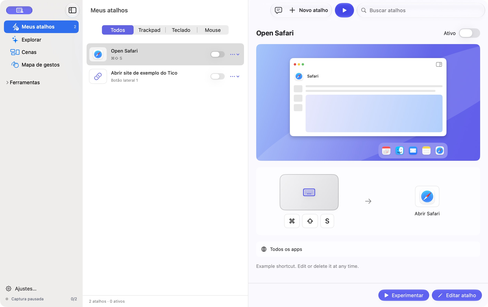

### 02 · Escolha da ação — alto atrito na continuidade

A área de prévia permanece ampla enquanto o catálogo exige rolagem. A escolha deve abrir a pergunta necessária no próprio contexto.

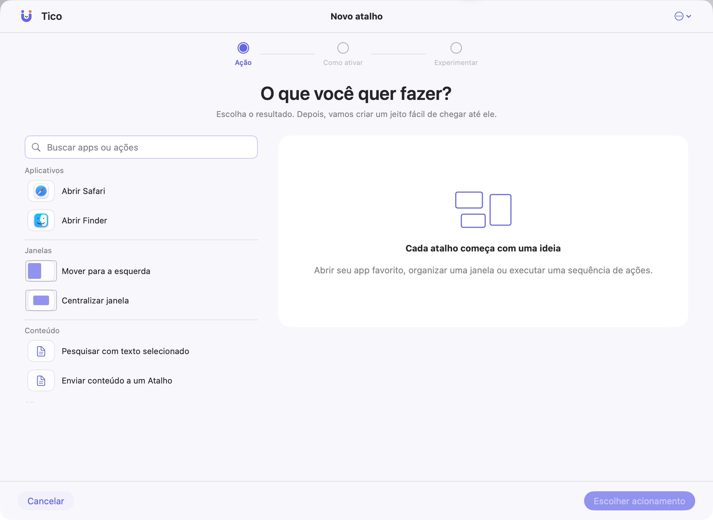

### 03 · Conteúdo — alto atrito

Campos de URL e parâmetro antecedem Google/Apple. Colocar receitas primeiro e revelar configuração customizada quando escolhida.

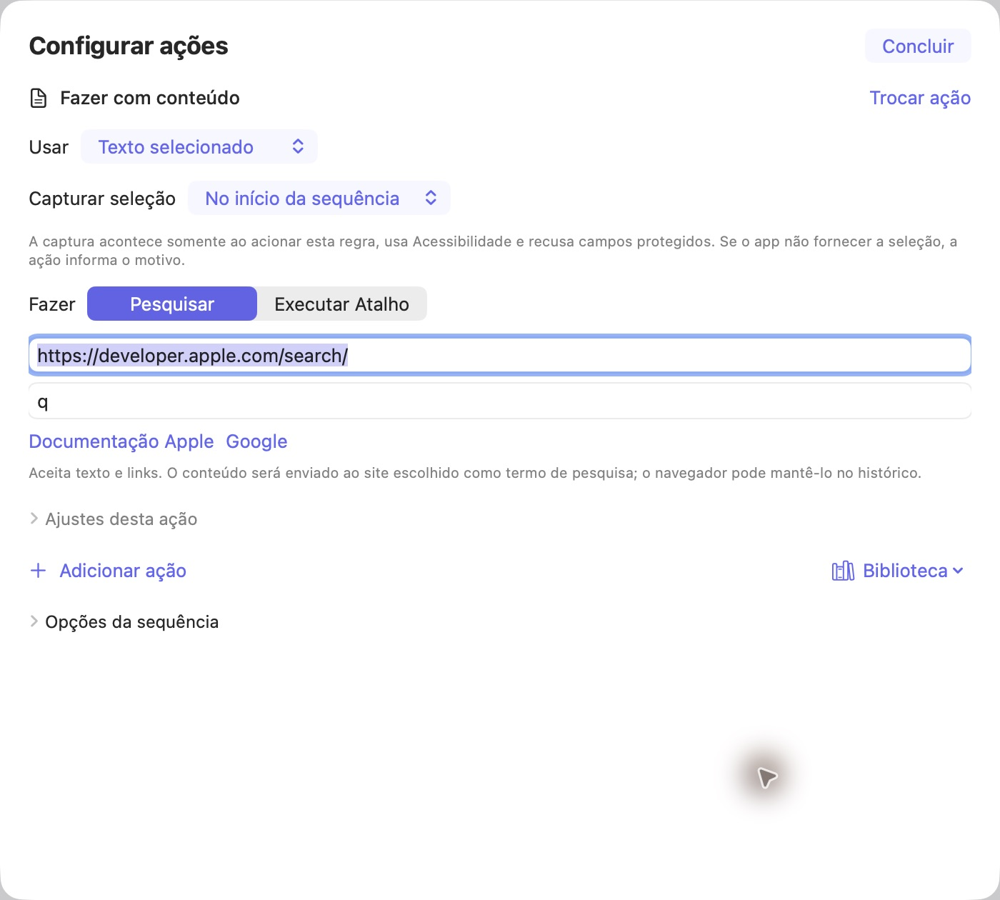

### 04 · Teclado — atenção

A representação é reconhecível; a área de gravação pode ser mais direta e evoluir para o resultado reconhecido.

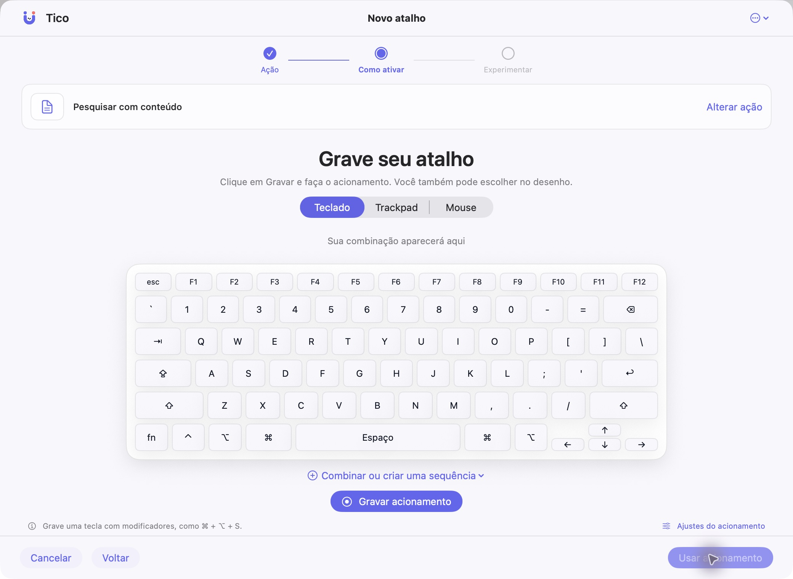

### 05 · Trackpad — alto atrito

Resumo, desenho, legenda e pickers repetem a escolha. Gravar ou escolher visualmente deve preceder combinações e ajustes.

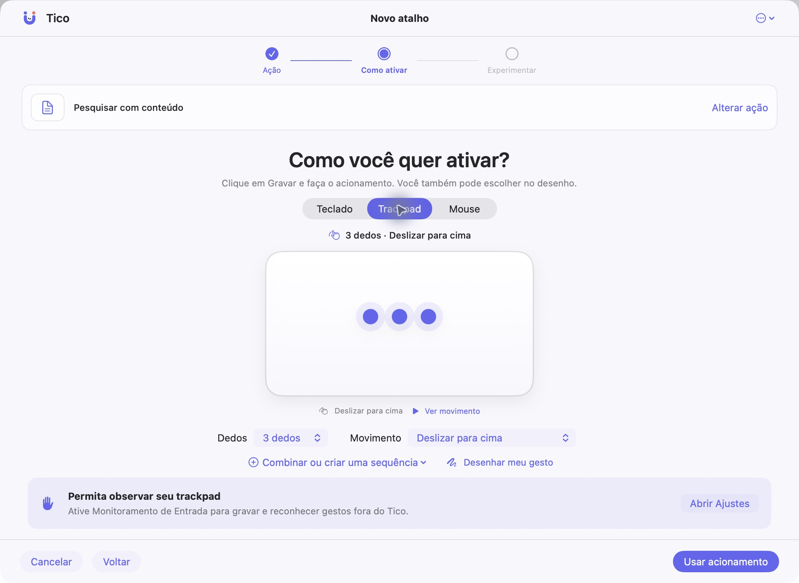

### 06 · Revisão — base útil

Preservar a relação acionamento → resultado. Tornar concreto o destino da pesquisa e distinguir ensaio de execução.

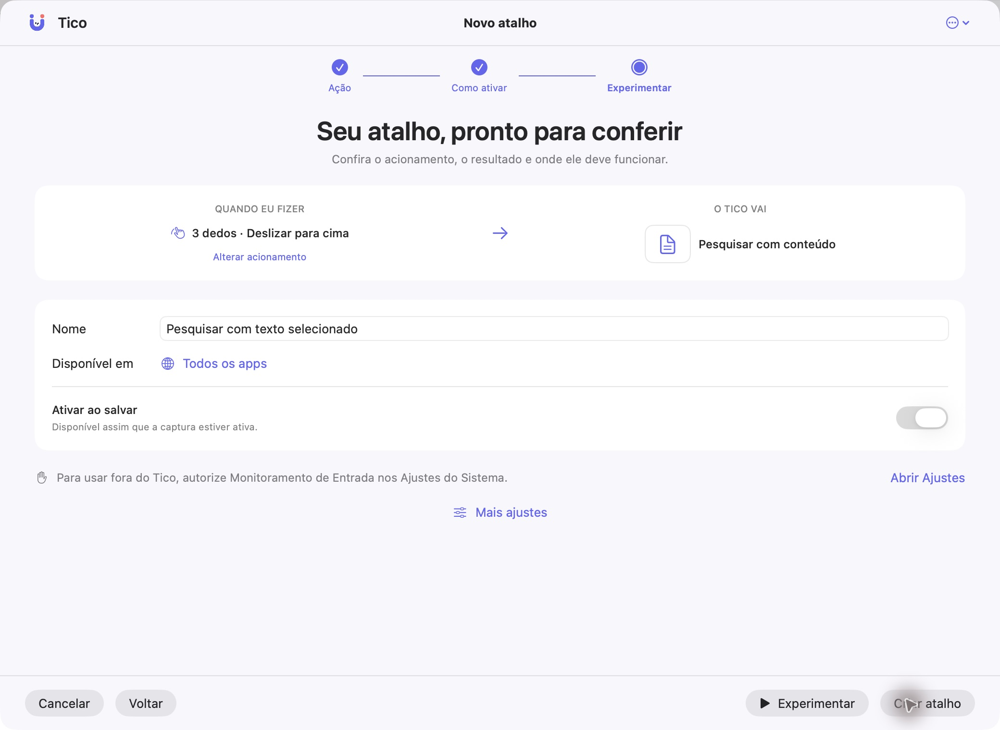

### 07 · Mapa — alto atrito conceitual

Três ações pares por linha e ícones genéricos ocupam muito espaço. Preferir consulta compacta e detalhe selecionado.

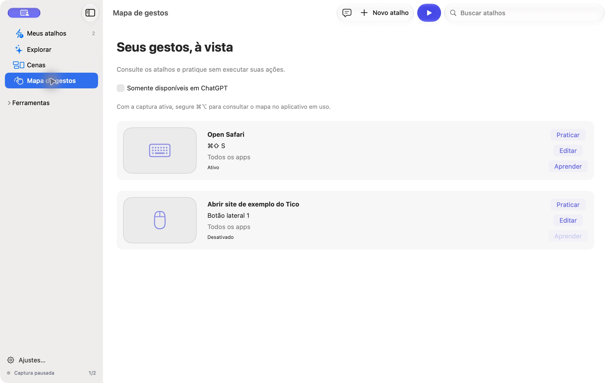

### 08 · Iniciar aprendizado — atenção

A confirmação do objetivo pode explicar a consequência de modo curto e já apresentar o acionamento.

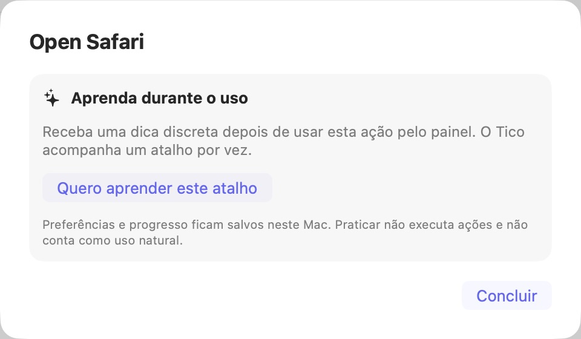

### 09 · Objetivo ativo — alto atrito

O contador está claro, mas o acionamento não aparece. Dar prioridade ao próximo uso e recolher manutenção.

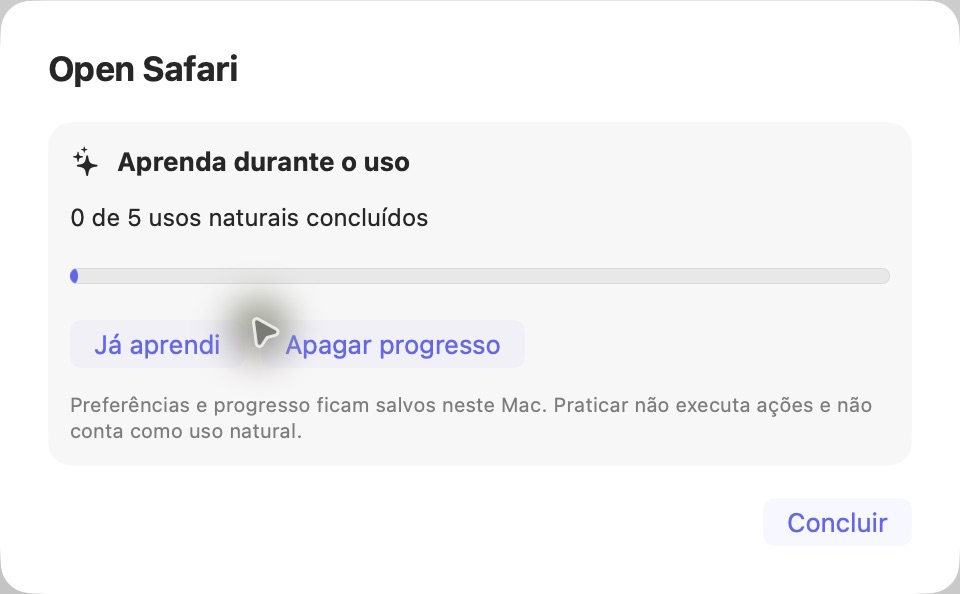

### 10 · Cenas vazias — alto atrito de hierarquia

“Nova cena” deve ser a ação dominante. Rotinas podem aparecer depois da primeira cena, com estado compacto.

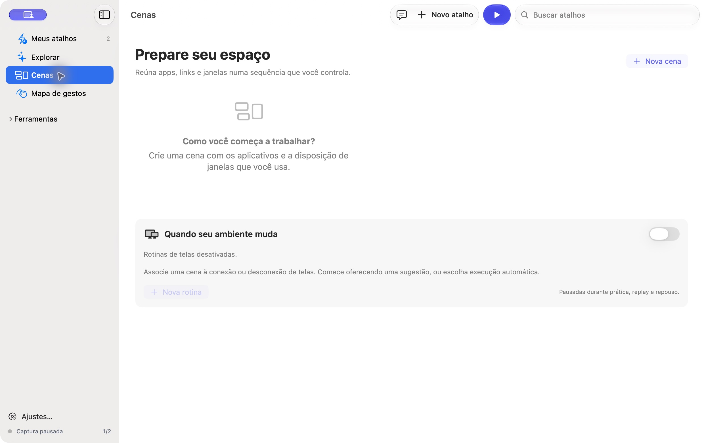

### 11 · Nova cena — alto atrito no início

“Editar cena” e aviso laranja surgem antes da primeira escolha. Começar por guardar disposição ou montar cena.

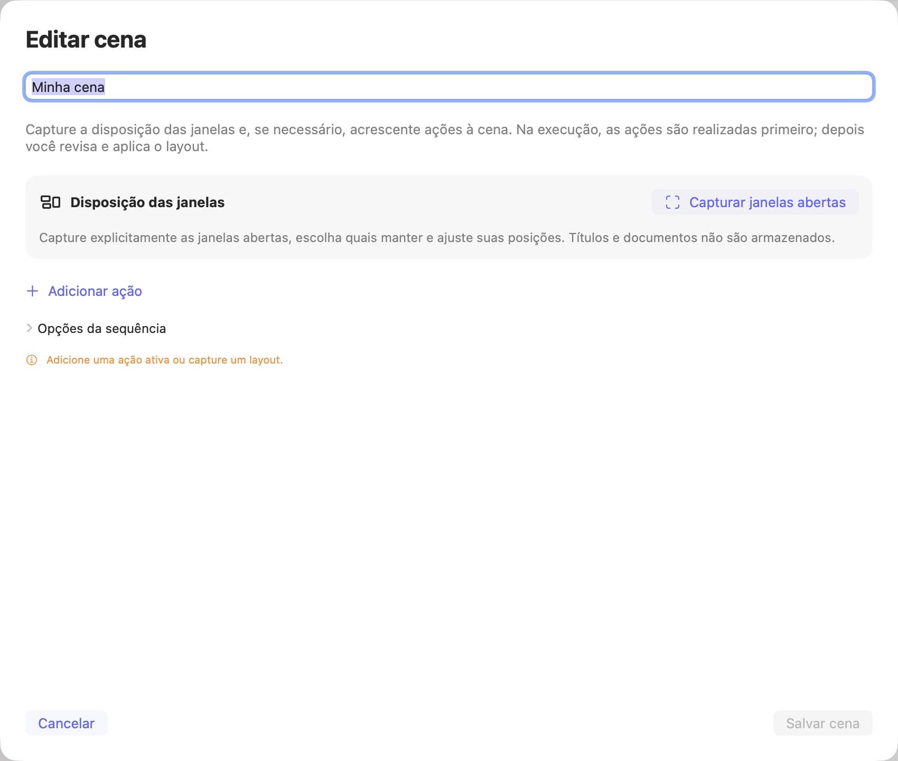

### 12 · Rotina — alto atrito

Transformar nome, evento, cena e comportamento em composição contextual. O botão final precisa comunicar o estado salvo.

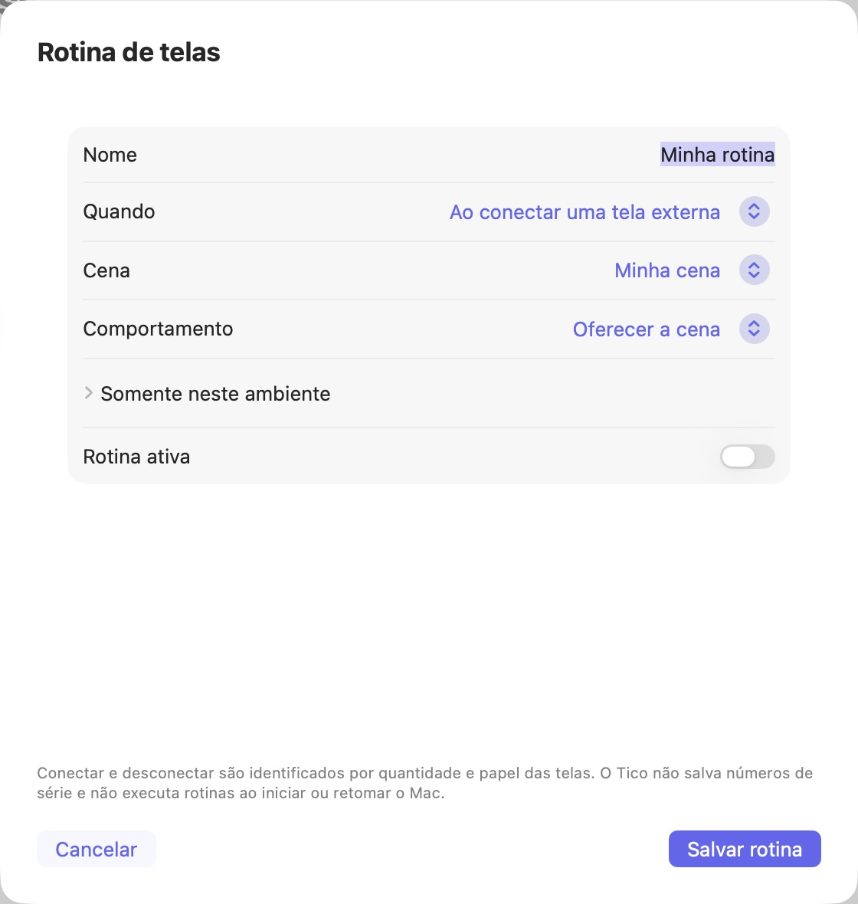

### 13 · Ambiente da rotina — alto atrito

Seis seletores exigem combinar dimensões mentalmente. Oferecer condição compreensível e ajustes específicos sob demanda.

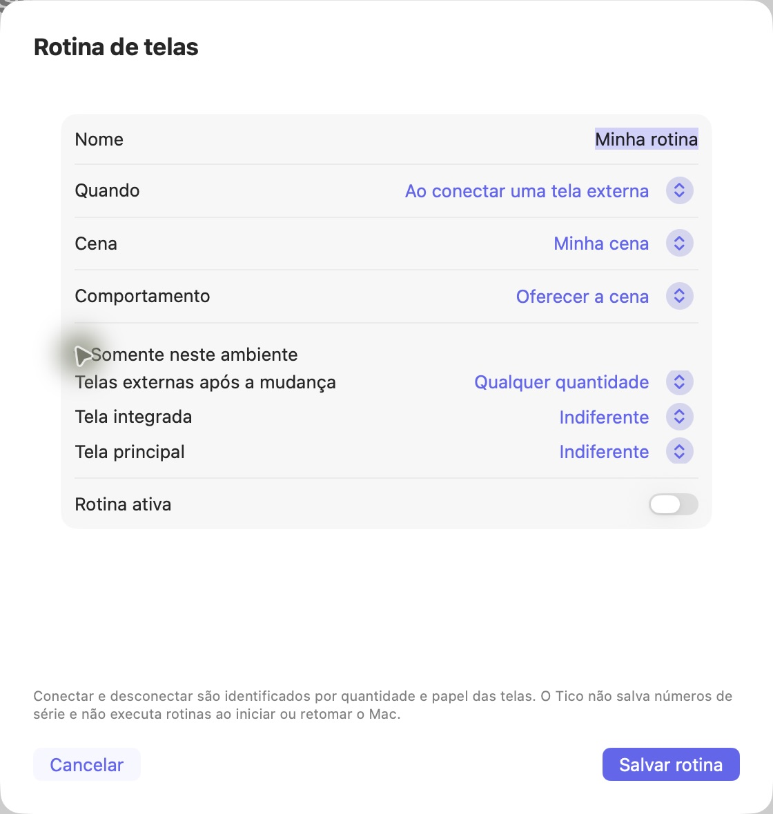

### 14 · Explorar — atenção

Receitas por resultado são uma boa base. Unificar nomes, catálogo e entrada dos modelos; a barra deve acompanhar o contexto.

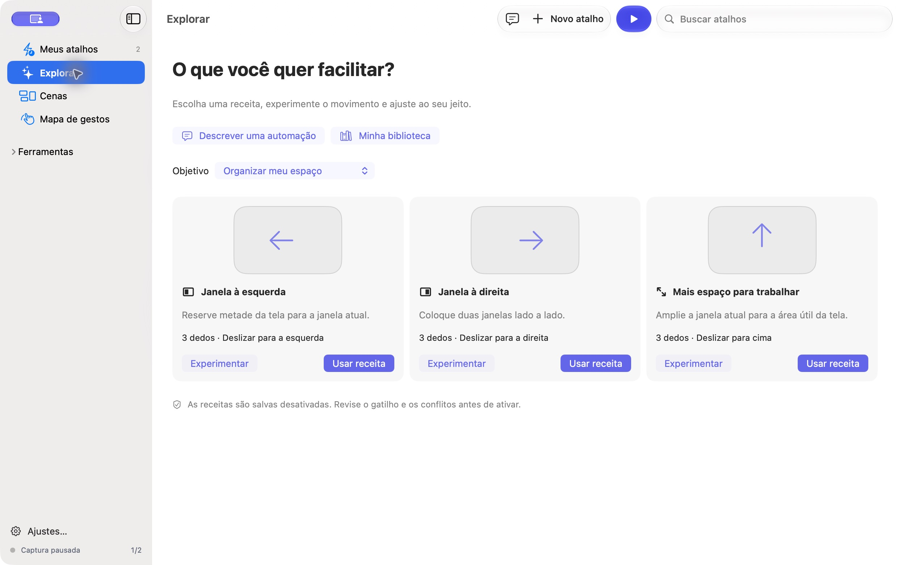
